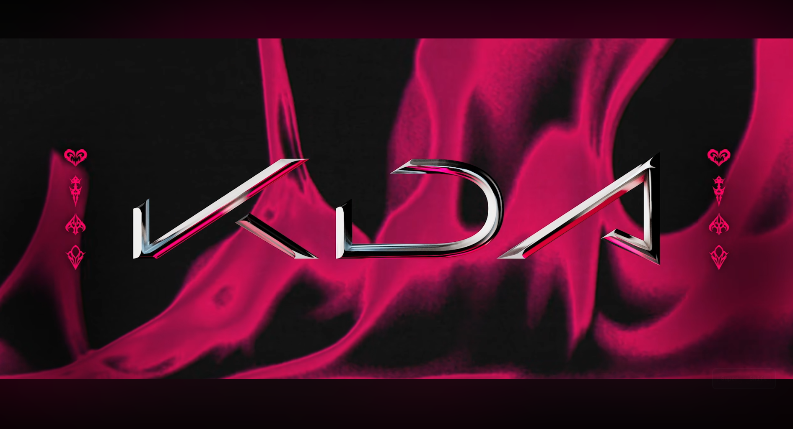

# K/DA Firestarter theme for Omarchy

A dark plum-and-magenta K/DA *FIRESTARTER* theme: ember-toned plum
backgrounds, magenta accent (`#f5427e`), Yaru-magenta icons, and a curated
set of 52 K/DA wallpapers that cycle through the desktop.



> Wallpaper art: © Riot Games (K/DA / League of Legends). Non-commercial fan
> collection. Contact for removal if requested.

## Requirements

Uses the [Fit-Width Background plugin](https://github.com/huyhuyhuy8s/ambient-background)
(`thearesia.background`) so portrait and square wallpapers render edge-to-edge
with a glowing ambient letterbox instead of black bars.

## Install

```bash
omarchy plugin add https://github.com/huyhuyhuy8s/ambient-background --enable
omarchy theme install https://github.com/huyhuyhuy8s/omarchy-kda-firestarter-theme
```

## Remove

```bash
omarchy theme remove kda-firestarter
omarchy plugin disable thearesia.background
omarchy plugin remove thearesia.background --yes
omarchy plugin enable omarchy.background
```

## Contents

- `backgrounds/` — 52 numbered K/DA wallpapers (cycle order preserved)
- `colors.toml`, `shell.lock.toml`, `icons.theme` — theme colors, lock shell palette, icon set
- `preview.png`, `preview-unlock.png`, `unlock.png` — previews and lock screen art

## License

Theme configuration is MIT. Wallpaper images remain © Riot Games, Inc.
(K/DA, League of Legends). Powerful-other fan art pieces are credited to
their artists where identifiable. Not affiliated with or endorsed by Riot
Games.
